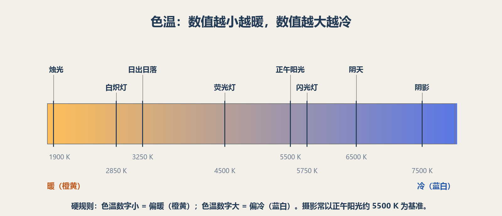
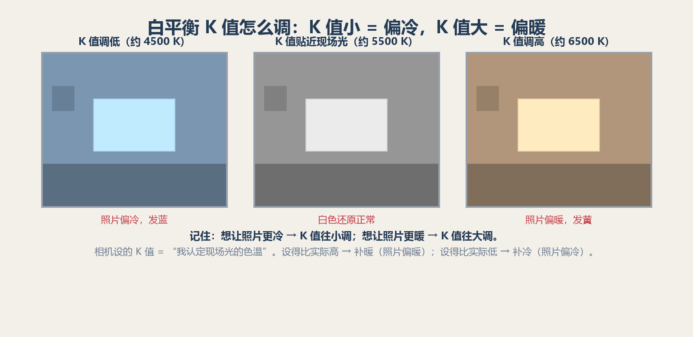

# 第 12.5 课：色温与白平衡——决定照片是冷是暖的那个参数

第 10 课提过一句要紧的话：照片偏暖或偏冷，首先是颜色解释问题，不必用曝光补偿来处理。这一课把这件事讲透。**白平衡**是相机上一个独立的参数，和 ISO、光圈、快门并列，但它管的是颜色不是明暗。这一课讲清三件事：光为什么会让照片偏色、相机怎么把白色还原成白、那个经常被你加减的数字（K 值）到底什么意思、怎么调。

先记住一个画面：同一个房间，手机自动拍出来是"正常"的白色；如果你用一台没设好的相机或一张老式胶片去拍，可能整张发黄或发蓝。差别不在曝光，而在**白平衡**。

## 1. 光是有"颜色"的

不同光源发出来的光，颜色其实不一样：

- 白炽灯、暖黄灯：发**黄**
- 荧光灯：发**青绿**
- 正午阳光：发**白**（摄影把它当作标准）
- 阴天、阴影：发**蓝**

这些偏色平时很难察觉，因为**人眼会自动"校准"**：你坐在暖黄灯泡下，看白纸还是白的；走到阴天里，看白墙也还是白的。大脑把现场光"脑补"掉了。

**相机没有这个自动校准**。它老老实实记录光本身的颜色——暖灯下拍的物体就会偏黄，阴天拍的就会偏蓝。所以相机需要你（或它的自动程序）告诉它："现场的光是偏暖还是偏冷的，把这份偏色扣掉。"这个设定，就是**白平衡**。

```text
暖黄灯下拍白纸：人眼看到白的，相机如实记录成偏黄
                       ↓
        白平衡的作用：告诉相机把这份黄扣掉，白纸还原成白
```

## 2. 色温：用数字描述光色（开尔文 K）

相机怎么"说"现场光的冷暖？用一个数字：**色温**，单位是开尔文（K）。

色温的原始定义来自物理学：把一个"黑体"（理想发光物体）加热到不同温度，它发出的光的颜色不同。温度高，发蓝白；温度低，发橙黄。于是就用这个温度来命名光的颜色。

这里有一个**最反直觉、也最常被记反的规律**：

> **色温数字越小，光越偏暖（橙黄）；数字越大，光越偏冷（蓝白）。**

"小=暖、大=冷"，和"温度高=热"的日常直觉相反，所以特别容易搞混。请把它当成一个硬规则记住。

常见光源的大致色温如下：

| 光源 | 大致色温 |
|---|---|
| 烛光 | 约 1800–2000 K |
| 白炽灯、暖黄灯 | 约 2700–3000 K |
| 日出、日落 | 约 3000–3500 K |
| 荧光灯 | 约 4000–5000 K |
| 正午阳光 | 约 5500 K |
| 电子闪光灯 | 约 5500–6000 K |
| 阴天 | 约 6500 K |
| 蓝天下的阴影 | 约 7000–8000 K |



上图：一条从左到右的色温标尺。左边是暖色（橙黄），右边是冷色（蓝白）。注意数值越小越偏暖、越大越偏冷——这就是后面调 K 值的依据。（原创生成示意图，非真实照片）

**为什么摄影把"正午阳光约 5500 K"当作基准？** 因为胶片的日光型标准、数码相机的默认白平衡、闪光灯都大致校准在 5500 K 附近。它不是"最正确"的光，只是一个大家共用的参照点。低于它偏暖，高于它偏冷。

## 3. 白平衡：告诉相机"现场光该扣掉多少色"

明白了色温，白平衡就一句话：

> **白平衡是"我认定现场光是什么色温"这个设定。相机按这个设定去补偿，把白色还原成白。**

具体说，你在相机里设一个色温值（比如 5500 K 或"日光"），相机的意思是："我假设现场光是 5500 K 的。既然偏色来自这个光，我就把它对应的黄/蓝扣掉，让白墙变白、灰卡变灰。"

- 设定得**准** → 白色还原成白色，整体中性。
- 设定得**偏** → 整张照片跟着偏：偏暖或偏冷。

所以白平衡**不等于调色、不等于加饱和度**。它只管一件事：把中性色（白、灰）的中性基准定对，从而决定整张照片是冷是暖。至于颜色鲜明不鲜明、偏不偏得好看，属于后面调色阶段的事，这一课只把白色基准定对。

## 4. 相机里的白平衡设置：每一档都讲

不管手机还是相机，白平衡通常有这几类。自动挡用得多，但另外几档在极端光下是救命稻草。

**（1）AWB：自动白平衡。**
相机或手机自己分析画面，猜一个现场色温。**近年的相机和手机在这一项上进步很大**：很多手机和相机开始借助 AI / 机器学习识别场景和光源——识别到人脸、室内暖光、户外阴天、食物、舞台灯光等，会据此自动调整白平衡；不少手机还能在相册里一键校正偏色、甚至慢慢学习你的使用偏好。所以**日常场景下 AWB 通常可以直接信任**，这也是大多数手机默认就开自动的原因。

它的局限仍然存在：光线很偏、或画面里没有白/灰这类中性色参照时，自动判断仍可能猜偏；不同品牌、不同机型猜出来的倾向也不完全一样（这也是有人觉得"某某手机偏黄/偏白"的一部分来源）。遇到这种情况，才轮到下面几档——预设、K 值、自定义——出场。

**（2）预设档。**
对应常见光源，一拍脑袋选一个：**日光、阴天、阴影、白炽灯、荧光灯、闪光灯**。原则是"现场是什么光，就选哪一档"：

- 白炽灯下 → 选"白炽灯"，相机把偏黄扣掉，还原中性。
- 阴天/阴影下 → 选"阴天/阴影"，把偏蓝扣掉。
- 闪光灯下 → 选"闪光灯"。
- 正午晴天户外 → "日光"即可。

**（3）K 值手动。**
直接输入一个色温数字（例如 5200、6500 K）。这是最精确的一档，也最能微调。想多暖一点、多冷一点，直接改数字。**这是这一课最希望你练熟的一档**，因为它逼你去想"现场到底是多少 K、我要不要偏"。

**（4）自定义白平衡。**
对着现场一张白纸或灰卡拍一张，相机记住"这就该是白/中灰"，之后按它来。最准，适合产品拍摄、肤色要准的棚拍等要求严格的场景。

**白平衡在相机上的入口**，各品牌位置不同（菜单、Fn 键、快捷设置），但选项就是上面这四类。手机多半只有"自动 + 几个预设 + 一个色温滑块"，原理一样。

## 5. 怎么调 K 值：加加减减的逻辑（重点，别记反）

手动 K 值这一档，最重要的不是背数值，而是**记住方向**。很多人在这里记反，我们把因果拆开看。

相机里那个 K 值，是**"我认定现场光色温"**。设它时要注意：设得高和设得低，照片会往相反方向偏。

- 你把 K 值设得**高于**现场实际光色温 → 相机以为"现场光比实际更冷" → 为了还原，它会**多补暖** → 照片**偏暖**。
- 你把 K 值设得**低于**现场实际光色温 → 相机以为"现场光比实际更暖" → 它会**多补冷** → 照片**偏冷**。

把结论压成一句好记的话：

> **想让照片更暖 → K 值往高调（加大）；想让照片更冷 → K 值往低调（减小）。**



上图：同一样品、同一光线，只改相机里的 K 值。K 值往小调，照片偏冷（蓝）；K 值贴近现场光，白色还原；K 值往大调，照片偏暖（黄）。**记住：K 值小=冷，K 值大=暖**。（原创生成示意图，非真实照片）

**为什么方向是这样，而不是反过来？** 用一个例子讲透：现场其实是白炽灯（约 2800 K，偏黄）。如果你把 K 值设成 **2800 K**，相机说"现场就是 2800 K 的黄光"，它把这份黄正好扣掉，白纸还原成白。但如果你把 K 值**误设成 6500 K**（以为现场是阴天那么冷），相机以为"现场偏冷、得补暖"，于是一边扣蓝一边加黄，结果白纸就发黄了——**K 值设高，照片反而偏暖**。

所以你会发现：**补偿方向永远和"你以为的光色"相反**。要想要暖的成片，就告诉相机"现场光很冷"，它才会去补暖；反之亦然。

**几个可直接套用的例子：**

- 在正午阳光（约 5500 K）下拍，发现偏黄，想还原中性 → 把 K 值设成 5500 附近。
- 在阴天（约 6500 K）拍，发现偏蓝，想还原中性 → 把 K 值设成 6500 附近（告诉相机"现场冷"，它补暖）。
- 白炽灯（约 2800 K）下，想要还原中性 → K 值往 2800–3200 设。
- 想要一张偏冷（清冷、科技感）的照片 → 把 K 值**调低**。
- 想要一张偏暖（黄昏、怀旧、温暖）的照片 → 把 K 值**调高**。

## 6. 环境色温与调整的意义：还原，还是表达

调白平衡前，先做一件事：**判断现场是什么光**。看环境、看主光源方向、看阴影颜色，大致估一个 K 值。然后决定你要哪种目标：

**目标 A：还原中性。** 纪实、产品、证件照、需要肤色准确的时候，让白色还原成白。方法：选对应的预设档，或用 K 值贴近现场光，或用自定义白平衡对准白纸/灰卡。

**目标 B：故意偏冷/偏暖，表达情绪。** 这是摄影的创作自由，不是"错误"：

- 清晨、清冷、孤独、科技感 → 偏冷（K 值调低）。
- 黄昏、温暖、怀旧、温馨 → 偏暖（K 值调高）。
- 保留钨丝灯、夕阳等环境光的色彩来营造气氛，是常见做法（第 10 课也提醒过：可以保留夕阳、钨丝灯的色彩来表气氛）。

**数值的意义**就在这里：每一个 K 值都对应一种"认定的现场光色"，也对应一种整张照片的冷暖基调。你不是在"修一个错误"，而是在**决定这张照片想给人冷还是暖的感受**。

**混光场景要注意。** 室内日光 + 钨丝灯、路灯 + 店铺灯，现场没有单一"正确"色温。这时选**主光源**定基准，其余光的偏色可以保留（往往更自然），不必强求全图中性。

## 7. 练习与常见误区

**练习：给同一物体在不同光下"还原白色"。**

找一个白纸或灰卡，分别放在：暖白灯泡下、荧光灯下、窗边日光下、阴影里。每种光下，依次用 ①自动白平衡、②对应预设档、③手动 K 值、④自定义白平衡各拍一张，比较哪张把白色还原得最准。再各拍一张"故意偏暖"和"故意偏冷"的，写下情绪感受。这会让你把 K 值的方向彻底记牢。

**常见误区：**

1. **白平衡不是调色。** 它只管白色/中性基准与冷暖；饱和、色调是另一回事，这里不展开。
2. **别只靠自动。** 自动在极端光（很暖、很冷、混光）下会猜偏；学会预设和 K 值更稳。
3. **别用曝光补偿调偏色。** 偏黄偏蓝是颜色解释问题，不是明暗问题（第 10 课讲过）。
4. **拍了 RAW 就不用担心？** 拍 RAW 的话，白平衡只是存在文件里的一个"建议值"，后期可以重算；JPEG 则当场锁定。所以重要场合要么现场设准白平衡，要么留 RAW 便于后期调整。

## 8. 下一步

白平衡定的是整张照片的冷暖骨架。拍的时候设好，能省去很多后期。接下来进入构图与色彩表达时，冷暖会被反复用到；到了后期阶段，还能对白平衡做更精细的调整。先把"K 值小=冷、K 值大=暖、往哪调变冷往哪调变暖"记牢，这一课就成了。
